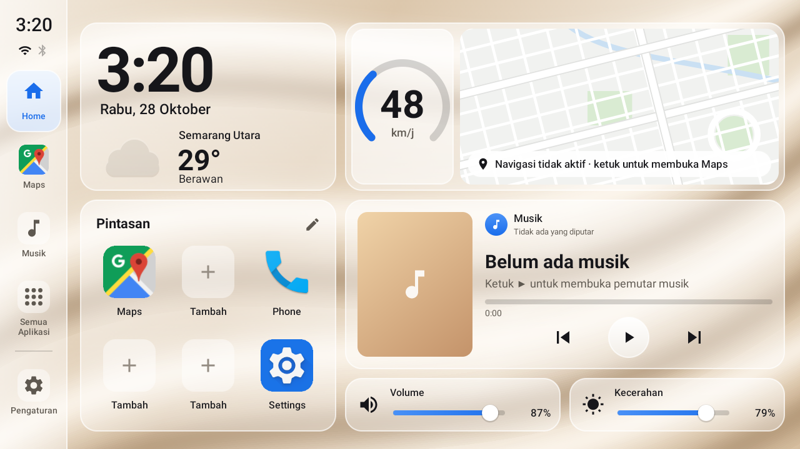
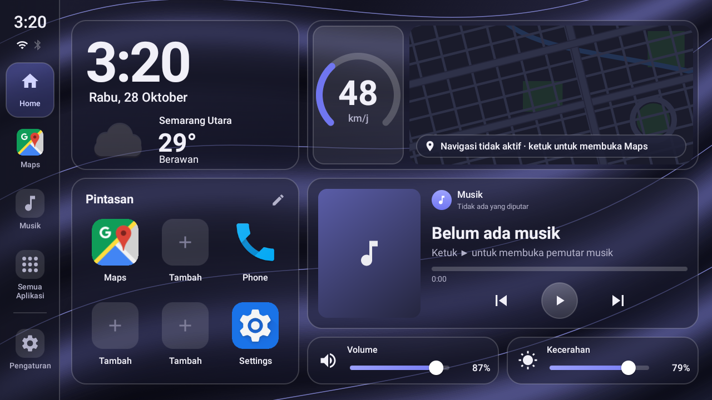
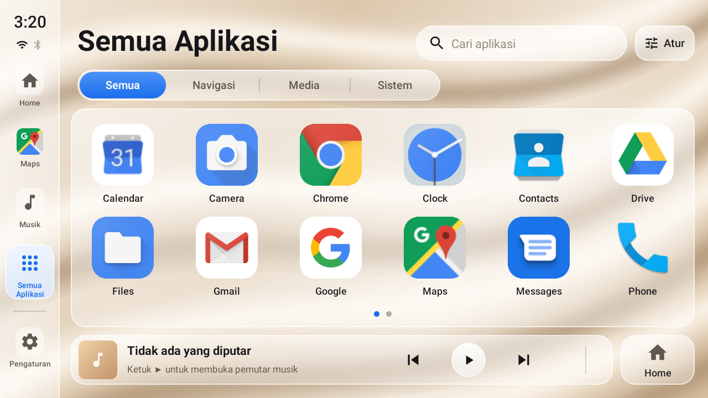
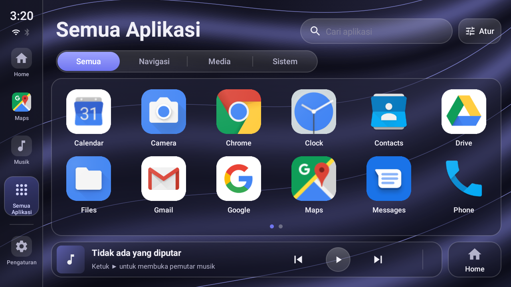
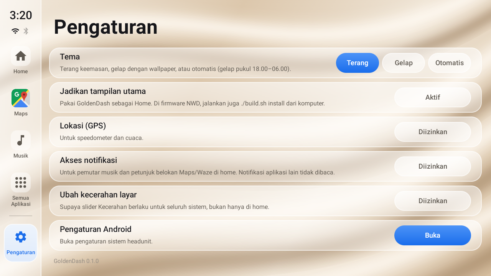
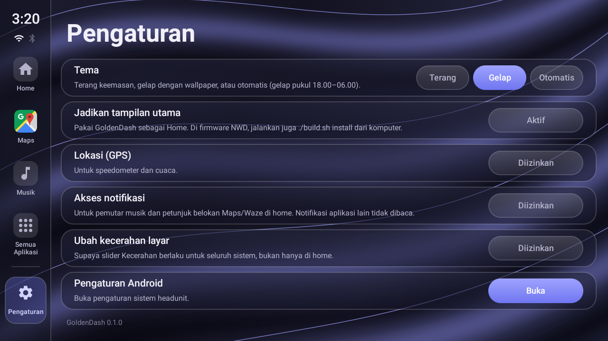

<h1 align="center">GoldenDash</h1>

<p align="center">
  
  
</p>

<p align="center">
  A lightweight, free, open-source launcher for Android car headunits (Android 7 or newer): a glass dashboard with
  clock and weather, GPS speedometer, turn-by-turn hints from Google Maps/Waze, a player card for any music app,
  volume and brightness sliders, and Light, Dark or Auto themes. No account. Designed for the NWD K2401 (1280×720).
</p>

<p align="center">
  ⚠️ <b>Unofficial.</b> GoldenDash is a community launcher. It is not made, supported or endorsed by NWD or any
  headunit manufacturer.
</p>

<p align="center">
  <a href="https://github.com/agungpmbd/goldendash/releases/latest"></a>
  <a href="https://github.com/agungpmbd/goldendash/releases"></a>
  <a href="LICENSE"></a>
  
  
  <br>
  
  
  
</p>

<p align="center">
  <a href="README.md">Bahasa Indonesia</a> | <b>English</b>
</p>

## About

Many stock headunit launchers are heavy, rigid and can't be customised. GoldenDash replaces them with a single
screen that shows what you need while driving: time, weather, speed, the next turn, music, volume and brightness.
Everything is reachable with a thumb, without opening other apps.

Written in plain Java with no libraries and no Gradle; the APK is about 80 KB. The background is drawn once, GPS
only runs while the home screen is visible, and song progress only updates while its card is on screen, so idle CPU
stays low. The interface is in Indonesian.

## Features

- **Home:** large clock and date, plus weather and city name from GPS ([Open-Meteo](https://open-meteo.com), free,
  no API key).
- **Speedometer:** GPS speed on a 0–140 km/h ring. It drops to 0 on its own when the GPS signal is lost (tunnels,
  basements).
- **Navigation:** distance and turn instructions are read from the navigation notification of **Google Maps**,
  **Waze**, Sygic or OsmAnd. Tap the panel to return to the navigation app. The map behind it is decorative.
- **3×2 shortcuts:** filled automatically (Maps, Spotify, Phone, Radio, Bluetooth, Settings). Tap ✏️ or long-press
  an icon to change it.
- **Player card:** album art, title, artist, progress and previous/play/next for any music app (Spotify, YouTube
  Music, JOOX, radio, ...). A ♡ button appears when the app provides one.
- **Volume and Brightness sliders:** they follow changes made with steering-wheel buttons or by the system.
- **All Apps:** search, All/Navigation/Media/System tabs, and a 6×2 grid you swipe page by page.
  - Long-press an icon to add it to the shortcuts, open its app info, or hide it.
  - **Atur** (Arrange) sorts A–Z or by most opened, and brings hidden apps back.
- **Themes:** **Light** (golden cream silk), **Dark** (blue-violet folds with glowing edges) or **Auto** (dark from
  18:00 to 06:00). Switches instantly, no restart. Set it in **⚙ Pengaturan › Tema**.
- **Settings:** the status of each permission, each with a button to set it.

## Screenshots

| Light | Dark |
|---|---|
|  |  |
|  |  |
|  |  |

<sub>Taken on an Android 10 1280×720 emulator. The apps shown are the emulator's stock apps.</sub>

## Installation

### Without a computer (from a USB drive)

1. Download `goldendash-<version>.apk` from [Releases](https://github.com/agungpmbd/goldendash/releases/latest)
   and copy it to a USB drive.
2. On the headunit, open the APK in a file manager, tap **INSTALL**, then **OPEN**. If asked, allow installing from
   unknown sources.
3. Allow **Location** when asked.
4. Open **⚙ Pengaturan** (Settings) in GoldenDash and tap the button on each row:
   - **Akses notifikasi** (notification access): for the player card and turn hints.
   - **Ubah kecerahan layar** (change brightness): so the brightness slider applies system-wide.
   - **Jadikan tampilan utama** (set as home): choose GoldenDash as the Home app.
5. Run the [pre-drive checklist](#disclaimer) with the car parked.

> **NWD firmware:** the default launcher is chosen by a system property that can only be changed over ADB. Without
> ADB, the headunit may switch back to the stock launcher after you press Home or restart it. GoldenDash can still
> be opened from the app list. To make it permanent, use the method below once.

### With ADB (recommended for NWD)

Enable USB debugging or ADB over WiFi on the headunit, then from a computer:

```bash
adb connect 192.168.1.17:5555        # your headunit's IP
./build.sh install
```

`./build.sh install` installs the APK, grants all permissions and makes GoldenDash the default launcher, including
the NWD property `persist.nwd.launcher.default`.

**Updating:** install the new APK over the old one. Settings, shortcuts and theme are kept.

## Supported devices

GoldenDash needs **Android 7.0 or newer** and is designed for a **1280×720 landscape** screen. The layout scales
from a 1280×720 design, so other landscape screens stay proportional.

| Device | Screen | Android | Status |
|---|---|---|---|
| Android 10 emulator | 1280×720 | 10 | ✅ tested: all screens, both themes, GPS, weather, sliders |
| NWD K2401 (Allwinner sun50iw10) | 1280×720 | 10 | ⚠️ main target, not yet tested on real hardware |
| Other Android headunits (FYT, MTK, Rockchip, …) | 1280×720 | 7+ | ⚠️ should work; NWD-specific property doesn't apply |
| Other landscape screens | 800×480 and up | 7+ | ⚠️ scaled proportionally, not tested |

Reports from other headunits help a lot: open an [issue](https://github.com/agungpmbd/goldendash/issues) with the
model, screen size and Android version.

## Changes to the headunit

Everything GoldenDash changes, and how to undo it. **GoldenDash does not remove, disable or modify other apps.**
Without ADB, the only changes are standard Android permissions that you grant yourself.

| Change | When | How to undo |
|---|---|---|
| NWD default launcher `persist.nwd.launcher.default=com.goldendash.launcher` | Only via `./build.sh install` | `adb shell setprop persist.nwd.launcher.default com.android.launcher` |
| HOME app preference | `./build.sh install`, or when you pick it in Settings | Android Settings › Apps › Default apps › Home app |
| "Modify system settings" permission (brightness) | `./build.sh install`, or when you allow it | Android Settings › Apps › GoldenDash › Modify system settings |
| Notification access | `./build.sh install`, or when you allow it | Android Settings › Notification access › GoldenDash |
| System screen brightness | When you move the brightness slider | Move it again, or set it in Android Settings |

To go back to the stock launcher completely:

```bash
adb shell setprop persist.nwd.launcher.default com.android.launcher
adb shell cmd package query-activities -c android.intent.category.HOME   # find the stock launcher
adb shell cmd package set-home-activity <package>/<activity>
adb uninstall com.goldendash.launcher
```

## Privacy

- **No account, no ads, no analytics.** There is no GoldenDash server.
- **Location** is used on the device for the speedometer. For weather, coordinates (4 decimals) are sent to
  [Open-Meteo](https://open-meteo.com) at most every 30 minutes, and the city name is looked up with Android's
  built-in Geocoder.
- **Notification access** is only used to read media sessions (title, artist, artwork) and the navigation
  notifications of Google Maps, Waze, Sygic and OsmAnd. Other apps' notifications are not read, and nothing is sent
  anywhere.

## Building from source

Requirements: macOS or Linux, JDK 17, the Android SDK (`build-tools` and `platforms/android-35`) in
`~/Library/Android/sdk` or `$ANDROID_HOME`, and `adb`.

```bash
brew install openjdk@17
brew install --cask android-commandlinetools android-platform-tools
export PATH=/opt/homebrew/opt/openjdk@17/bin:$PATH
sdkmanager --sdk_root=$HOME/Library/Android/sdk "build-tools;35.0.0" "platforms;android-35"

./build.sh              # → build/goldendash.apk
./build.sh install      # build + install + permissions + default launcher
DEVICE=1.2.3.4:5555 ./build.sh install   # when more than one ADB device is connected
```

The signing key (`goldendash.keystore` + `.keystore-pass`) is created on the first build and is not in the
repository. **Back up both**: without the same key, a new APK can't update an installed one.

**Your own dark wallpaper (optional):** put a 16:9 image at `res/drawable-nodpi/wall_dark.jpg` (for example
1600×900) and rebuild. Without it, the Dark theme uses the built-in folds. Git ignores this file.

See the [Indonesian README](README.md#struktur) for the source layout. All positions are in 1280×720 design units
scaled by `Ui.px()`; both themes' colours live in `Ui.theme()`.

## Disclaimer

**Use at your own risk.** This software is provided "as is", without warranty of any kind (see [LICENSE](LICENSE)).

> ⚠️ **Test before driving.** After installing GoldenDash, with the car parked, make sure all of these still work:
> reverse camera, Bluetooth phone calls, audio and steering-wheel buttons, navigation, and returning home with the
> Home button. Don't operate the screen while driving.

GoldenDash is not affiliated with NWD, Google, Waze, Spotify or any other brand mentioned here. All trademarks
belong to their owners.

## Thanks

- [KlikDash](https://github.com/ashafizullah/klikdash) (MIT): inspiration for the lightweight, Gradle-free launcher
  approach for NWD headunits, the build script, and the ISRG root certificates for Android 7.0.
- [Material Icons](https://fonts.google.com/icons) by Google (Apache 2.0) for the interface icons.
- [Open-Meteo](https://open-meteo.com) (CC BY 4.0) for weather data.

## License

[MIT](LICENSE) © 2026 agungpmbd
